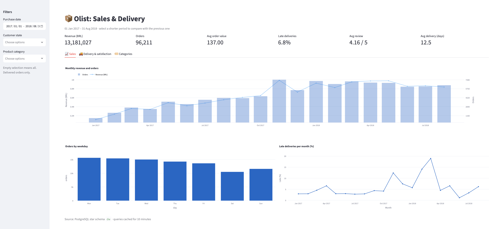
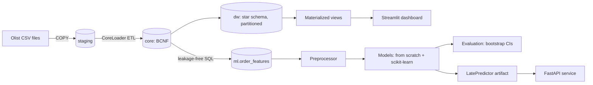

# Olist ML Platform: Database Engineering, Analytics and Late-Delivery Prediction


An end-to-end data project on 100k real e-commerce orders from Brazil (Olist): a normalized
PostgreSQL database, a partitioned data warehouse, an interactive dashboard, machine learning
models implemented **from scratch** and verified against scikit-learn, and a validated prediction API.



## What this project demonstrates

| Area | Evidence |
|---|---|
| **Database design** | Keys and functional dependencies verified with SQL on real data; schema normalized to BCNF; 11 tables with primary/foreign keys, CHECK and UNIQUE constraints ([docs/02](docs/02_database_design.md)) |
| **Query optimization** | `EXPLAIN ANALYZE` of B-tree, composite and covering indexes; automated scaling benchmark up to 3M rows: index lookup ~4,700× faster than a sequential scan ([docs/03](docs/03_indexing_benchmarks.md)) |
| **Transactions** | Two concurrent sessions reproduce non-repeatable reads, phantoms, lost updates, write skew and a deadlock under each isolation level ([docs/04](docs/04_transactions_isolation.md)) |
| **Data warehousing** | Star schema with surrogate keys, range partitioning with partition pruning, materialized views, `ROLLUP` ([docs/05](docs/05_data_warehouse_olap.md)) |
| **Data visualization** | Streamlit + Plotly dashboard with filters and period comparisons; analysis figures ([docs/06](docs/06_dashboard.md)) |
| **Machine learning** | Logistic regression (gradient derivation, convexity), CART decision tree and neural network (backpropagation, Adam) implemented with NumPy; gradient checks; results match scikit-learn ([docs/08](docs/08_ml_from_scratch.md)) |
| **Evaluation** | Leakage-free features, time-based split, paired bootstrap confidence intervals, threshold selection, ablation, error analysis ([docs/07](docs/07_features_eda.md), [docs/09](docs/09_evaluation.md)) |
| **Software engineering** | Python package with OOP design patterns (Repository, Factory, Adapter, abstract base classes), 16 automated tests, CI, FastAPI service with input validation and a training–serving consistency check ([docs/10](docs/10_api.md)) |

## Architecture



## Key results

**Prediction task:** at purchase time, predict whether an order will arrive after its estimated
delivery date. 96,203 orders, 6.8% late; chronological split (train 2017-01 to 2018-02,
validation 2018-03 to 2018-05, test 2018-06 to 2018-08).

| Model | Test PR-AUC (95% CI) | Test ROC-AUC |
|---|---:|---:|
| Random baseline | 0.036 | 0.500 |
| Logistic regression (from scratch) | 0.057 [0.051, 0.065] | 0.667 |
| Neural network (from scratch) | 0.062 [0.056, 0.070] | 0.695 |
| Decision tree (from scratch) | 0.073 [0.066, 0.081] | 0.703 |
| Gradient boosting (scikit-learn) | **0.076** [0.068, 0.087] | **0.715** |

Main findings:
- **Delivery time drives satisfaction:** more than half of late orders get a 1-star review.
- **Lateness depends on the promise, not just distance:** remote states have the longest
  deliveries but low late rates, because their estimates are generous.
- **Distribution shift:** late rates of 6.6% / 10.1% / 3.6% in the three periods; a single
  validation period selected a model that was significantly worse on test.
- **Evaluation caught a real bug:** an implausible bootstrap interval revealed that average
  precision depended on the order of tied scores; it was fixed and covered by a test.

## Project structure

```
sql/                 staging, BCNF schema, indexes, analytical queries, star schema, views, features
src/olist_ml/
  db/                connection wrapper, warehouse repository
  etl/               staging → core loader
  features/          dataset sources, time split, preprocessing
  models/            base class, logistic regression, decision tree, neural network, factory, adapter
  evaluation/        metrics from scratch, bootstrap evaluator
  viz/               plotting functions
  api/               FastAPI service
  pipeline.py        deployable predictor
dashboard/           Streamlit app
scripts/             load, benchmark, experiments, EDA, training, evaluation
tests/               16 automated tests
docs/                design documents, results and figures
```

## Quick start

Requirements: Python 3.11+, PostgreSQL. Download the
[Olist dataset](https://www.kaggle.com/datasets/olistbr/brazilian-ecommerce) into `data/raw/`.

```bash
python3 -m venv .venv && source .venv/bin/activate
pip install -e ".[dev]"
./scripts/run_all.sh                        # database, warehouse, features, model, tests
streamlit run dashboard/app.py              # dashboard at http://localhost:8501
uvicorn olist_ml.api.main:app --reload      # API docs at http://127.0.0.1:8000/docs
```

Experiments: `python scripts/benchmark_indexes.py`, `python scripts/isolation_experiments.py`,
`python scripts/evaluate.py`.

## Documentation

1. [Setup](docs/01_setup.md)
2. [Database design and normalization](docs/02_database_design.md)
3. [Indexing, benchmarks and advanced SQL](docs/03_indexing_benchmarks.md)
4. [Transactions and isolation](docs/04_transactions_isolation.md)
5. [Data warehouse (OLAP)](docs/05_data_warehouse_olap.md)
6. [Dashboard](docs/06_dashboard.md)
7. [Features and exploratory analysis](docs/07_features_eda.md)
8. [Machine learning from scratch](docs/08_ml_from_scratch.md)
9. [Evaluation](docs/09_evaluation.md)
10. [Prediction API](docs/10_api.md)

## Limitations and next steps
- Only 20 months of data: seasonal effects cannot be separated from one-off events.
- Model selection should use rolling-origin evaluation over several time windows.
- Most remaining errors are local late deliveries, which need carrier and warehouse data.

## Author
Lilia Rouhi · [GitHub](https://github.com/liliarouhi)