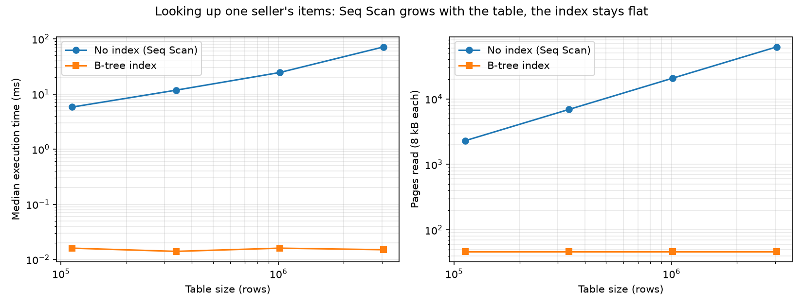

# 03 — Indexing and Query Optimization

Query: items of one seller (45 of 112,650 rows), measured with `EXPLAIN (ANALYZE, BUFFERS)`.

| Query | Index | Plan | Pages read | Time |
|---|---|---|---|---|
| `WHERE seller_id = ?` | none | Seq Scan | 2,167 | 60.1 ms |
| `WHERE seller_id = ?` | `(seller_id)` | Bitmap Index + Heap Scan | 46 | 3.1 ms |
| `... ORDER BY shipping_limit_at DESC LIMIT 10` | `(seller_id)` | Bitmap scan + top-N Sort | 46 | 3.0 ms |
| `... ORDER BY shipping_limit_at DESC LIMIT 10` | `(seller_id, shipping_limit_at)` | Index Scan Backward, no Sort | 13 | 0.1 ms |
| `SELECT price ... WHERE seller_id = ?` | `(seller_id) INCLUDE (price)` | Index Only Scan, 0 heap fetches | 5 | 0.9 ms |

## Findings
- PostgreSQL indexes primary keys and UNIQUE columns automatically, but not foreign keys.
- A composite index ordered as (equality column, sort column) removes the Sort node and lets LIMIT stop early.
- A covering index (`INCLUDE`) enables index-only scans; `VACUUM` updates the visibility map so no heap fetches are needed.
- Page counts (Buffers) are a more stable comparison than timings, which vary with caching.
- The three experimental indexes were merged into one: `(seller_id, shipping_limit_at) INCLUDE (price)`, since redundant indexes slow down writes.

Final indexes: `sql/02_indexes.sql`.

## Scaling benchmark

Script: `scripts/benchmark_indexes.py`. The order items table is replicated 1, 3, 9 and 27 times;
each copy gets its own seller ids, so a seller always has 45 rows while the table grows.
Each query runs once to warm the cache, then 5 measured runs; the median is reported.
Raw data: `docs/figures/index_benchmark.csv`.

| Rows | Seq Scan time | Seq Scan pages | Index time | Index pages |
|---:|---:|---:|---:|---:|
| 112,650 | 5.80 ms | 2,304 | 0.016 ms | 47 |
| 337,950 | 11.73 ms | 6,912 | 0.014 ms | 47 |
| 1,013,850 | 24.54 ms | 20,736 | 0.016 ms | 47 |
| 3,041,550 | 71.37 ms | 62,080 | 0.015 ms | 47 |

### Findings
- Pages read by the Seq Scan grow exactly linearly with table size (O(n)).
- The index reads 47 pages at every size: B-tree depth grows logarithmically, and at this
  scale it did not change at all.
- At 3 million rows the index lookup is about 4,700× faster.
- Seq Scan time grew less than linearly (27× rows, 12× time) because PostgreSQL switches to a
  Parallel Seq Scan on larger tables: the same amount of work is split across CPU cores.
- The 112k-row Seq Scan took 60 ms in the earlier single cold run and 5.8 ms here with a
  warm cache, which is why page counts are the more reliable metric.