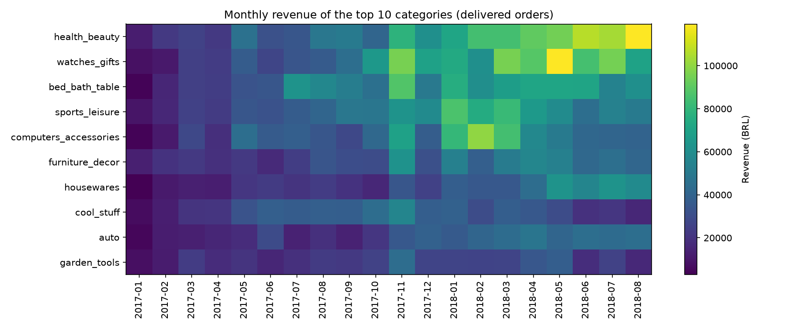
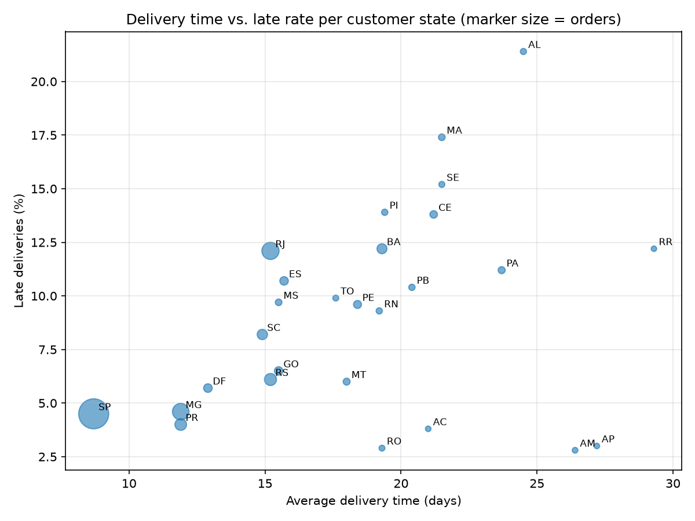

# 05 — Data Warehouse (OLAP)

Files: `sql/04_star_schema.sql`, `sql/05_materialized_views.sql`, `scripts/plot_olap.py`.

## Why a separate layer
The `core` schema is normalized for consistent writes (OLTP). Analytical queries need many joins
there, so a star schema (`dw`) is derived from it for reporting (OLAP).

## Star schema
Grain of the fact table: **one row per order item**.

| Table | Rows | Notes |
|---|---:|---|
| `dim_date` | 1,095 | one row per day 2016–2018, smart key `YYYYMMDD`, weekday/weekend flags |
| `dim_customer` | 99,441 | surrogate key; denormalized address + coordinates |
| `dim_seller` | 3,095 | surrogate key; denormalized address + coordinates |
| `dim_product` | 32,951 | surrogate key; English category, volume in cm³ |
| `fact_order_items` | 112,650 | measures: price, freight, delivery days, late flag, review score |

Dimensions are intentionally denormalized: fewer joins and simpler queries matter more than
avoiding redundancy in a read-only layer. Surrogate keys (integer identities) make joins cheaper
and decouple the warehouse from source identifiers.

## Partitioning
`fact_order_items` is range-partitioned by `purchased_date` (one partition per year plus a default).

| Partition | Rows |
|---|---:|
| 2016 | 370 |
| 2017 | 50,864 |
| 2018 | 61,416 |
| default | 0 |

**Partition pruning:** a query for January–June 2018 scans only `fact_order_items_2018`; the 2016
and 2017 partitions are skipped at planning time. The partition key must be part of the primary
key, which is why `core.orders` (referenced by foreign keys on `order_id` alone) stays unpartitioned
and partitioning is applied in the warehouse instead.

## Materialized views
| View | Rows | Purpose |
|---|---:|---|
| `mv_monthly_category_revenue` | 1,241 | revenue per month and category (valid window 2017-01 to 2018-08) |
| `mv_state_delivery` | 27 | order-level late rate, delivery time and review score per state |
| `mv_revenue_rollup` | 36 | months, quarter and year subtotals, and a grand total via `ROLLUP` |

Unique indexes allow `REFRESH MATERIALIZED VIEW CONCURRENTLY`, so dashboards can read during refresh.

`ROLLUP (year, quarter, month)` result (delivered orders, item prices only):

| Level | Value |
|---|---|
| 2016 | 40,471 BRL · 267 orders |
| 2017 | 5,962,902 BRL · 43,428 orders (Q4 highest: 2,362,046) |
| 2018 (to August) | 7,218,125 BRL · 52,783 orders |
| Grand total | 13,221,498 BRL · 96,478 orders |

Note: this total uses item prices only. The 15.42M figure in `docs/03` includes freight.

## Figures

