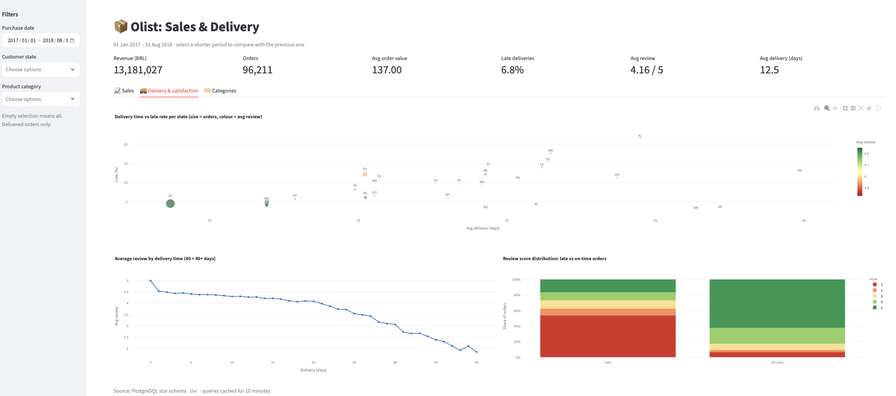

# 06 — Interactive Dashboard

Run: `streamlit run dashboard/app.py` (opens at http://localhost:8501).

## Architecture
- **Data access:** `src/olist_ml/db/warehouse.py`, a `WarehouseRepository` (Repository pattern)
  over the `dw` star schema. The dashboard never writes SQL; it calls repository methods that
  return pandas DataFrames.
- **Filters:** date range, customer states and product categories, passed as one immutable
  `Filters` object and turned into parameterized SQL (no string formatting of values).
- **Caching:** `st.cache_data` stores query results for 10 minutes, so repeated filter
  combinations do not hit the database.
- **KPI comparison:** each KPI is compared with the previous period of equal length, shown only
  when that period lies inside the valid data window (2017-01 to 2018-08).

## Views
| Tab | Charts |
|---|---|
| Sales | monthly revenue and orders (dual axis), orders by weekday, late deliveries per month |
| Delivery & satisfaction | delivery time vs late rate per state, review by delivery time, review distribution for late vs on-time orders |
| Categories | revenue treemap (top 15), monthly revenue heatmap (top 8) |

## Findings
- **Delivery time drives satisfaction:** the average review falls from about 4.5 for fast
  deliveries to about 2 for deliveries of 40+ days.
- **Late orders are rated badly:** more than half of late orders receive 1 star, while about
  60% of on-time orders receive 5 stars.
- **Lateness is seasonal:** it jumps in November 2017 (Black Friday) and peaks at about 19%
  in February–March 2018.
- **Weekly pattern:** Monday has the most orders, Saturday the fewest.

These results motivate the machine learning task: predicting at purchase time whether an order
will arrive after its estimated delivery date.