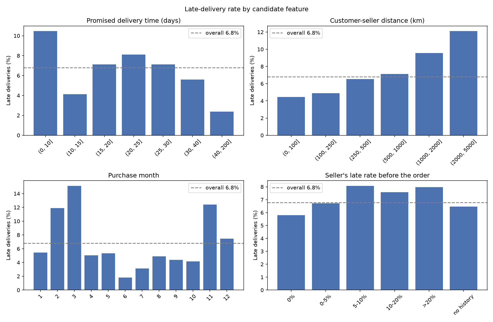
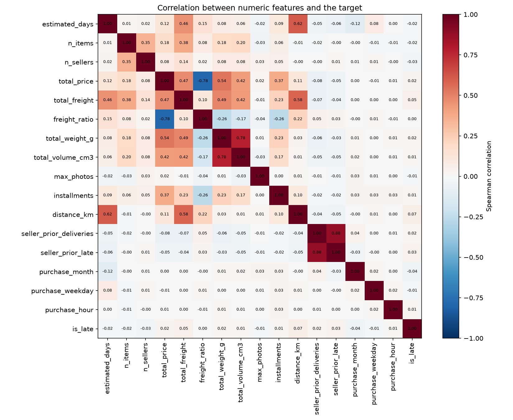

# 07 — Features and Exploratory Analysis

Files: `sql/06_features.sql`, `src/olist_ml/features/dataset.py`, `scripts/eda.py`.

## Task
Binary classification: at purchase time, predict whether an order will arrive after its
estimated delivery date (`is_late`). One row per delivered order purchased between 2017-01 and
2018-08 (valid window, see docs/03).

## Leakage rule
Only information available when the order is placed may become a feature. Excluded: carrier and
customer delivery dates, delivery duration, review scores, order status.
Seller history is computed from an event stream per seller (purchases and deliveries sorted by time),
so each order only counts deliveries that **finished before its purchase**. A naive per-seller late
rate over all orders would leak future outcomes into training.

## Features
| Group | Features |
|---|---|
| Time | purchase month, weekday, hour; promised delivery time (`estimated_days`) |
| Order | items, sellers, price, freight, freight/price ratio, weight, volume, photos |
| Geography | customer state, seller state, same state, customer–seller distance (Haversine, km) |
| Payment | main payment type, installments |
| History | seller's previous deliveries and late deliveries |

Haversine distance: `d = 2R·arcsin(√(sin²(Δφ/2) + cos φ₁·cos φ₂·sin²(Δλ/2)))`, R = 6,371 km.

## Dataset
- 96,203 orders, 6,531 late (**6.79%**): imbalanced about 1:14. Accuracy is misleading
  (always predicting "on time" gives 93.2%), so models are evaluated with precision, recall and
  PR-AUC. A random classifier has PR-AUC ≈ 0.068.
- Missing values: weight and volume 16, photos 1,330 (products without metadata); none elsewhere.

## Late rate by feature

| Promised days | ≤10 | 10–15 | 15–20 | 20–25 | 25–30 | 30–40 | >40 |
|---|---|---|---|---|---|---|---|
| Late % | 10.47 | 4.12 | 7.11 | 8.12 | 7.13 | 5.61 | 2.37 |

| Distance (km) | ≤100 | 100–250 | 250–500 | 500–1000 | 1000–2000 | >2000 |
|---|---|---|---|---|---|---|
| Late % | 4.46 | 4.89 | 6.53 | 7.12 | 9.57 | 12.11 |

| Month | 1 | 2 | 3 | 4 | 5 | 6 | 7 | 8 | 9 | 10 | 11 | 12 |
|---|---|---|---|---|---|---|---|---|---|---|---|---|
| Late % | 5.44 | 11.88 | 15.12 | 5.02 | 5.33 | 1.80 | 3.15 | 4.88 | 4.39 | 4.18 | 12.40 | 7.46 |

| Seller's earlier late rate | 0% | 0–5% | 5–10% | 10–20% | >20% | no history |
|---|---|---|---|---|---|---|
| Late % | 5.80 | 6.72 | 8.07 | 7.59 | 7.96 | 6.47 |

## Correlation

All Spearman correlations with the target are small (|ρ| ≤ 0.07); the largest are distance (0.070)
and freight (0.053).

## Findings
- **Low correlation does not mean no effect.** `estimated_days` has ρ = −0.021, yet the late rate
  ranges from 10.5% (short promises) to 2.4% (long promises) with a non-monotonic shape.
  Spearman only measures monotonic association. Linear models need binned or transformed versions
  of such features; tree-based models and neural networks can learn them directly.
- **Distance is the strongest numeric signal** and is monotonic: 4.5% under 100 km, 12.1% over 2,000 km.
- **Month effects are probably events, not stable seasonality.** With only 20 months of data, each
  month appears once or twice; the peaks match Black Friday 2017 and early 2018. A model may
  overfit to them.
- **Distribution shift:** the most recent months (June–August 2018) have much lower late rates
  (1.8–4.9%) than earlier periods, so a time-based test set is harder than a random split.
  Time-based splitting is still required to avoid training on the future.
- Seller history adds a weak signal (5.8% vs about 8%).

## Modelling decisions (from this analysis)
- Time-based split: train on older orders, test on the most recent months.
- Median imputation plus a missing-value indicator for weight, volume and photos.
- Log transform for skewed amounts (price, freight, weight, volume); standardization for
  gradient-based models.
- One-hot encoding for payment type and states; the most frequent categories kept for product category.
- Class weights to handle the 1:14 imbalance.