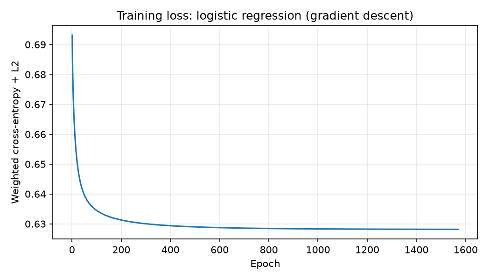

# 08 — Machine Learning from Scratch

Files: `src/olist_ml/features/preprocessing.py`, `src/olist_ml/models/base.py`,
`src/olist_ml/models/logistic_regression.py`, `src/olist_ml/evaluation/metrics.py`,
`tests/test_models.py`, `scripts/train.py`.

## Design
- `BaseModel` (abstract): every model implements `fit(X, y)` and `predict_proba(X)`, so
  from-scratch and library models are interchangeable in training and evaluation code.
- `Preprocessor`: learns medians, means, standard deviations and category lists **on the training
  set only**, then applies them to validation and test data (no leakage). Steps: log transform of
  skewed amounts, median imputation with missing-value indicators, standardization, one-hot bins
  for `estimated_days` (non-monotonic effect), one-hot encoding of the top 20 categories plus
  `other`. Result: 95 features.
- Metrics (ROC-AUC, PR-AUC, precision, recall, F1) are implemented from scratch.

## Logistic regression

Model: `p = σ(wᵀx + b)`, `σ(z) = 1 / (1 + e⁻ᶻ)`.

Loss (weighted binary cross-entropy with L2 regularization):

    L(w, b) = −(1/S) Σᵢ sᵢ [ yᵢ log pᵢ + (1 − yᵢ) log(1 − pᵢ) ] + (λ/2) ‖w‖²,   S = Σᵢ sᵢ

Balanced sample weights `sᵢ = n / (2 n_class)` give both classes equal total weight (1:14 imbalance).

Gradient. Since `σ'(z) = σ(z)(1 − σ(z))`, the derivative of each log-likelihood term with
respect to `zᵢ` is `yᵢ − pᵢ`, hence

    ∇w L = (1/S) Xᵀ (s ⊙ (p − y)) + λw,      ∂L/∂b = (1/S) Σᵢ sᵢ (pᵢ − yᵢ)

Convexity. The Hessian `(1/S) Xᵀ diag(sᵢ pᵢ(1 − pᵢ)) X + λI` is positive definite for λ > 0,
so the loss is strictly convex with a unique minimum, and gradient descent converges for a
small enough step size.

Numerical stability: `σ(z) = (1 + tanh(z/2)) / 2` never overflows, and `log(1 + e⁻ᶻ)` is
computed with `logaddexp`.

Training: batch gradient descent, learning rate 0.5, λ = 0.001, stopped when the loss decreases
by less than 10⁻⁷.

## Tests
- **Gradient check:** the analytic gradient matches central finite differences
  `(L(w + ε) − L(w − ε)) / 2ε` to within 10⁻⁶.
- The model separates linearly separable data with > 95% accuracy.
- The sigmoid stays finite for inputs of ±1000.
- ROC-AUC and PR-AUC match a hand-computed example.

## Results

Time-based split:

| Set | Period | Orders | Late |
|---|---|---:|---:|
| Train | 2017-01 to 2018-02 | 57,050 | 6.63% |
| Validation | 2018-03 to 2018-05 | 20,550 | 10.11% |
| Test | 2018-06 to 2018-08 | 18,603 | 3.61% |

Training: 1,570 epochs in 6.5 s, final loss 0.628.

| Set | ROC-AUC | PR-AUC | PR-AUC of random | Precision @0.5 | Recall @0.5 |
|---|---:|---:|---:|---:|---:|
| Validation | 0.686 | 0.174 | 0.101 | 0.151 | 0.725 |
| Test | 0.667 | 0.057 | 0.036 | 0.054 | 0.850 |

Largest coefficients: customer state dominates (AL +0.76, RJ +0.45, MA +0.45, CE +0.39 raise the risk;
MG −0.91, PR −0.75, SP −0.55, DF −0.48 lower it), `same_state` −0.52, `estimated_days` −0.42
(longer promises are late less often), seller state SP +0.40.

## Findings
- The model learns a real signal (PR-AUC 1.6–1.7× the random baseline), but performance is
  modest, as expected from the weak individual signals found in the EDA (|ρ| ≤ 0.07).
- **Distribution shift** between periods (late rates 6.6% / 10.1% / 3.6%) makes the test set
  much harder; the evaluation is honest because the split is chronological and features are leakage-free.
- With balanced weights the default threshold 0.5 favours recall over precision; the threshold
  is tuned on the validation set later.
- Distance is not among the top coefficients because states and `same_state` already carry most
  of its information (collinearity).
- A linear model cannot represent interactions (for example region × season); the next models
  (decision tree, neural network) can.
  