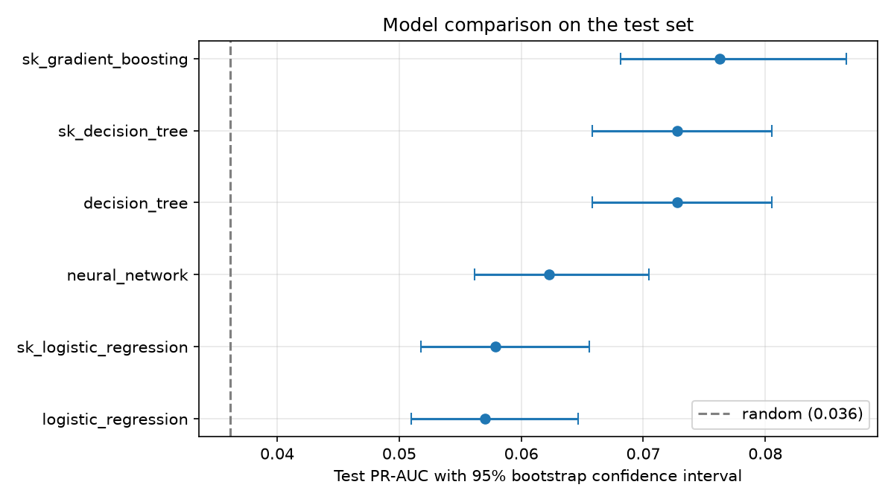
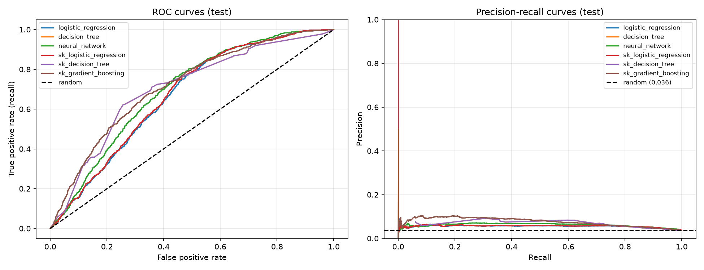

# 09 — Evaluation

Script: `scripts/evaluate.py`. Files: `src/olist_ml/evaluation/evaluator.py`,
`src/olist_ml/evaluation/metrics.py`, `src/olist_ml/models/sklearn_adapter.py`.
Raw results: `docs/figures/evaluation_results.csv`.

## Protocol
- Models and the decision threshold are **selected on validation** (March–May 2018) and
  reported once on **test** (June–August 2018), which is never used for any choice.
- Uncertainty: **paired bootstrap** over the test set (1,000 resamples with replacement). The same
  resamples are applied to every model, so the confidence interval of a *difference* between two
  models can be computed; if it excludes 0, the difference is significant.
- scikit-learn models are wrapped in an **Adapter** (`SklearnModel`) so they share the `BaseModel`
  interface and are trained with the same balanced sample weights.

## Verification against scikit-learn
- Logistic regression from scratch matches scikit-learn's coefficients and intercept (tolerance 10⁻³).
  The objectives are equal when `C = 1 / (λ·S)`, where S is the sum of sample weights.
- The from-scratch decision tree gives exactly the same predictions as `DecisionTreeClassifier`
  with the same depth and leaf size (identical PR-AUC and ROC-AUC on validation and test).
- ROC-AUC and PR-AUC from scratch match scikit-learn, including data with tied scores.

## A bug found by the evaluation
The first bootstrap gave the decision tree a test PR-AUC of 0.080 with a 95% interval of
[0.064, 0.080]: the point estimate sat exactly on the upper bound. The tree outputs only 125
distinct scores, and the first implementation of average precision ordered tied rows by their
position in the file, so the result depended on an arbitrary order. Average precision is now
computed over distinct thresholds, `AP = Σₙ (Rₙ − Rₙ₋₁) Pₙ`, as in scikit-learn, and a test with
heavily tied scores was added. The tree's corrected scores: validation 0.184 → 0.168,
test 0.080 → 0.073.

## Results

| Model | Val PR-AUC | Test PR-AUC (95% CI) | Test ROC-AUC |
|---|---:|---:|---:|
| Random baseline | 0.101 | 0.036 | 0.500 |
| Neural network (scratch) | **0.213** | 0.062 [0.056, 0.070] | 0.695 |
| Gradient boosting (sklearn) | 0.195 | **0.076** [0.068, 0.087] | **0.715** |
| Logistic regression (scratch) | 0.174 | 0.057 [0.051, 0.065] | 0.667 |
| Logistic regression (sklearn) | 0.174 | 0.058 [0.052, 0.066] | 0.671 |
| Decision tree (scratch) | 0.168 | 0.073 [0.066, 0.081] | 0.703 |
| Decision tree (sklearn) | 0.168 | 0.073 [0.066, 0.081] | 0.703 |

**Model selection.** Validation selects the neural network, but on test it is significantly worse
than gradient boosting: difference −0.014, 95% CI [−0.021, −0.007], better in 0% of resamples.

## Threshold and confusion matrix (selected model, test)
The threshold maximizing F1 on validation is 0.594. On test it gives precision 0.068
(1.9× the 3.6% base rate), recall 0.509 and F1 0.120.

| | Predicted late | Predicted on time |
|---|---:|---:|
| **Late** | 342 (TP) | 330 (FN) |
| **On time** | 4,706 (FP) | 13,225 (TN) |

The model flags 27.1% of orders and catches 342 of 672 late orders. The threshold was chosen in a
high-lateness period (10.1%), so it flags too many orders in the low-lateness test period (3.6%).

## Error analysis (late orders in the test set)

| Distance (km) | ≤250 | 250–500 | 500–1000 | 1000–2000 | >2000 |
|---|---:|---:|---:|---:|---:|
| Late orders | 361 | 93 | 102 | 55 | 52 |
| Recall | 0.465 | 0.409 | 0.451 | 0.691 | 0.885 |

| Customer state | SP | RJ | BA | MG | RS | PR | ES | MA |
|---|---:|---:|---:|---:|---:|---:|---:|---:|
| Late orders | 405 | 68 | 27 | 21 | 18 | 16 | 14 | 14 |
| Recall | 0.464 | 0.676 | 0.704 | 0.143 | 0.444 | 0.188 | 0.429 | 1.000 |

The model catches long-distance and north-eastern late orders well (88.5% beyond 2,000 km),
but **more than half of all late orders (361 of 672) are within 250 km**, mostly in São Paulo,
and only 46.5% of those are caught. Local delays depend on factors the features do not contain
(carrier capacity, warehouse problems).

## Ablation: removing `purchase_month`

| Model | Val with | Val without | Test with | Test without |
|---|---:|---:|---:|---:|
| Decision tree | 0.168 | 0.181 | 0.073 | 0.040 |
| Neural network | 0.213 | 0.214 | 0.062 | 0.073 |
| Gradient boosting | 0.195 | 0.215 | 0.076 | 0.058 |

Without the month, validation improves for all three models, while test drops sharply for the
tree models and improves for the network. The month helps in one period and hurts in another:
it is an **unstable feature**, as predicted in the EDA (docs/07). In the training data, summer
2017 had few late orders, and summer 2018 happened to repeat that pattern; with only one year of
history, this cannot be distinguished from coincidence.

## Conclusions
- All models beat the random baseline (best: 2.1× on test PR-AUC), but the signal available at
  purchase time is weak.
- **One validation period is not enough under distribution shift.** Validation (spring 2018,
  10.1% late) and test (summer 2018, 3.6% late) rank the models differently, and the selected
  model is significantly worse on test than the runner-up. The next step is rolling-origin
  evaluation: several consecutive train/validation windows, with models and features chosen by
  their average performance across windows.
- Seasonal features need several years of history before they can be trusted.
- The largest remaining error, local late deliveries, needs new data (carrier and warehouse
  information) rather than a different model.