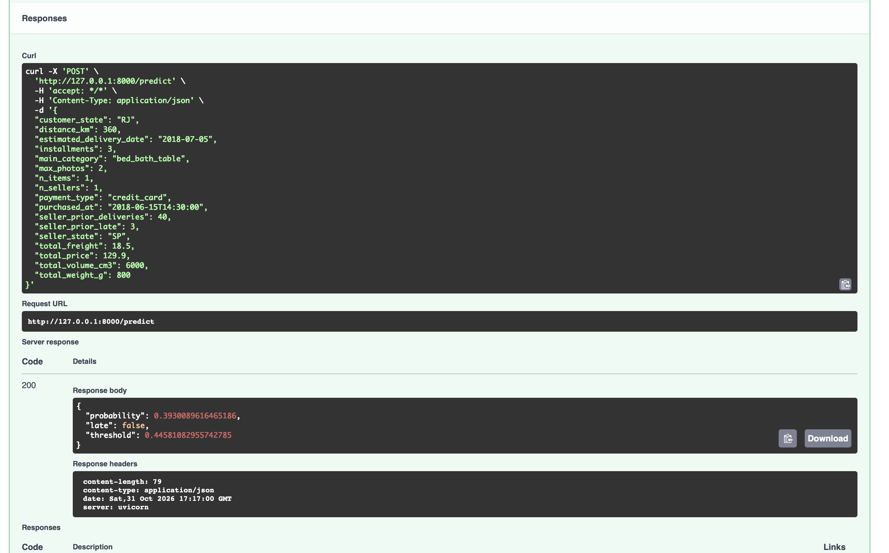
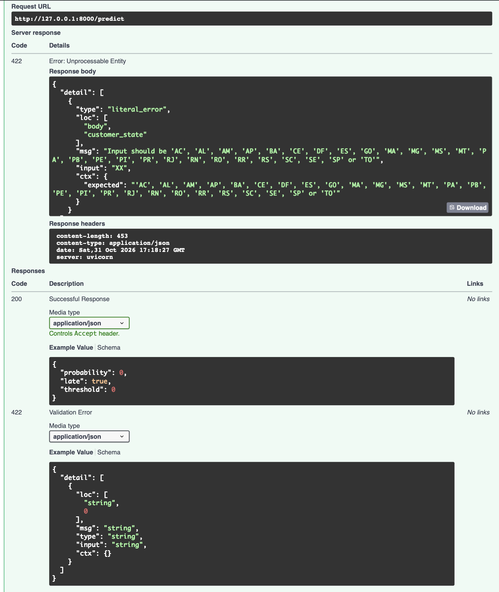

# 10 — Prediction API

Files: `src/olist_ml/pipeline.py`, `src/olist_ml/api/main.py`, `scripts/train_final.py`, `tests/test_api.py`.

## Run
    python scripts/train_final.py            # trains, checks consistency, saves artifacts/late_predictor.pkl
    uvicorn olist_ml.api.main:app --reload   # interactive docs at http://127.0.0.1:8000/docs

## Endpoints
| Method | Path | Purpose |
|---|---|---|
| GET | `/health` | service status and whether a model is loaded |
| GET | `/model` | model name, training period, threshold, test metrics |
| POST | `/predict` | probability of late delivery for one order |
| POST | `/predict/batch` | up to 1,000 orders in one request |

Example: an order from a seller in São Paulo to a customer in Rio de Janeiro (360 km, 20 promised
days) gets a late-delivery probability of 0.393, below the threshold 0.4458, so it is predicted on time:

    {"probability": 0.3930, "late": false, "threshold": 0.4458}

An unknown state code is rejected with HTTP 422 and a message listing the allowed values:

## Design
- **One artifact:** `LatePredictor` bundles the fitted preprocessor, the model and the decision
  threshold, so a model can never be served with the wrong preprocessing.
- **Input validation (Pydantic):** types, ranges, the 27 Brazilian state codes, payment types,
  and cross-field rules (delivery date after purchase, late deliveries ≤ deliveries,
  sellers ≤ items). Invalid requests are rejected with HTTP 422 before reaching the model.
- **Derived features are computed by the server** (month, ISO weekday, hour, promised days,
  freight ratio, same state), with the same definitions as `sql/06_features.sql`.
- **Training–serving consistency check:** `train_final.py` rebuilds raw requests for 2,000 test
  orders, sends them through the API feature code, and requires identical scores to the SQL
  features; otherwise it refuses to save the artifact. Result: passed.
- **Dependency injection:** endpoints receive the predictor from `get_predictor`; tests replace it
  with a stub, so the 6 API tests need neither a trained model nor a database.
- **Security note:** the artifact is a pickle file; only load artifacts you created yourself.

## Served model
Gradient boosting (scikit-learn), trained on 2017-01-05 to 2018-02-28, threshold 0.4458 chosen by
maximum F1 on validation.

| Test metric | Value |
|---|---:|
| PR-AUC | 0.0763 (base rate 0.0361) |
| ROC-AUC | 0.7151 |
| Precision at threshold | 0.0865 (2.4× the base rate) |
| Recall at threshold | 0.4345 |
| F1 | 0.1443 |

Choice note: gradient boosting was the best model on test, but validation had selected the neural
network (docs/09). For deployment all evidence is used; because the test set influenced this choice,
its test score is slightly optimistic. Production use would retrain on all data up to the latest
month and select models with rolling-origin evaluation.